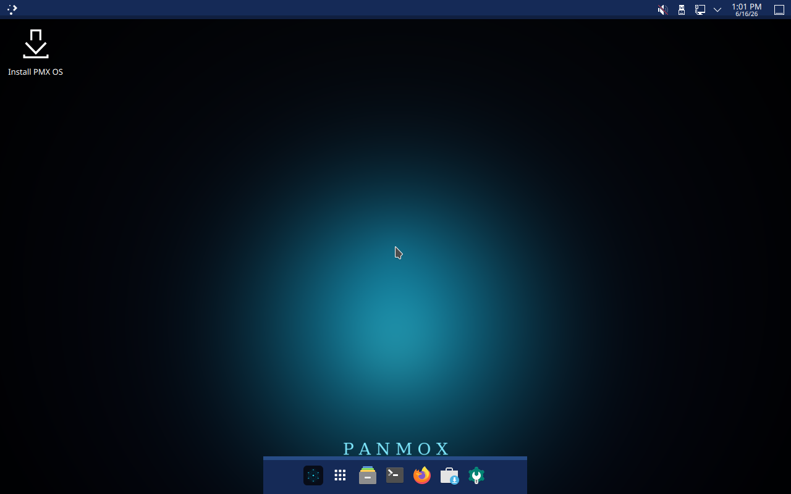
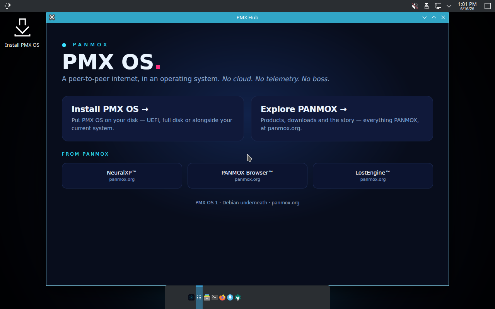
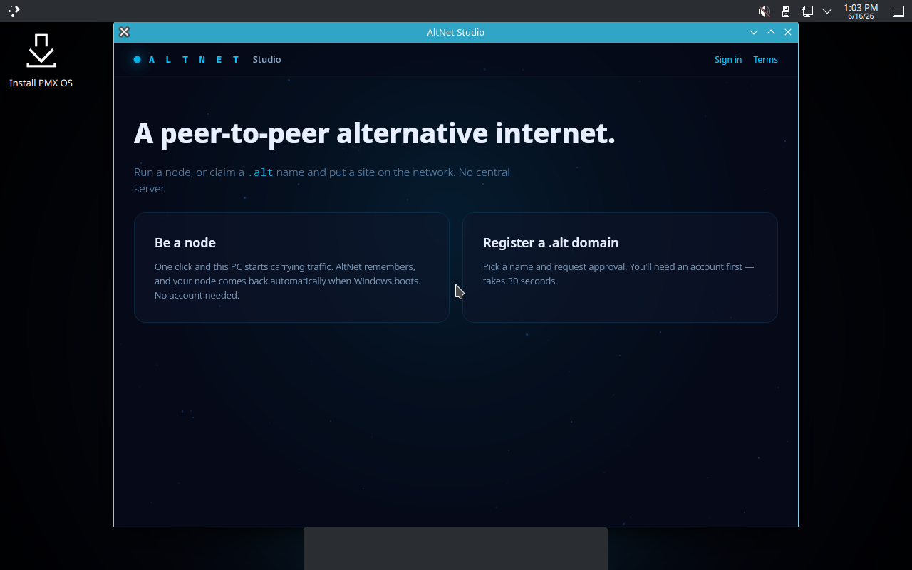
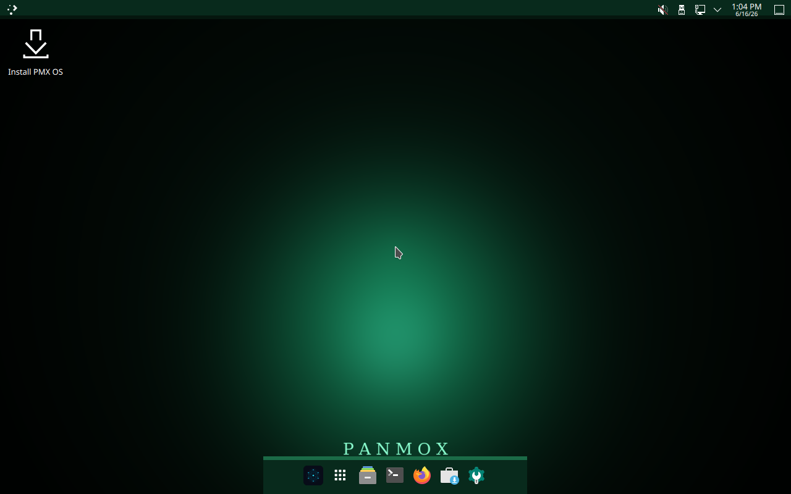

<div align="center">

# PMX OS

### A peer‑to‑peer internet. In an operating system.

A Debian‑based, KDE Plasma live operating system — custom‑themed and branded as a
**PANMOX** product, and the native home for the PANMOX catalog.

**No cloud. No telemetry. No boss.**

</div>

---



## What it is

PMX OS is a complete desktop operating system built on **Debian 12 (bookworm)** with a
**KDE Plasma** desktop rebuilt into something purely PMX. It boots on **UEFI and BIOS**,
runs live from a USB stick, and installs to disk with a fully rebranded **Calamares**
installer. This repository contains the **build system** — the scripts that assemble the
ISO with [Debian `live-build`](https://salsa.debian.org/live-team/live-build).

## Features

- **Custom KDE identity** — top bar + a floating, centred, ⅓‑width dock; Papirus‑Dark icons,
  KWin blur; a custom blue Plasma style (cyan accent, pink dot) on a cyan‑glow wallpaper.
- **Phosphor mode** — a one‑click toggle that flips the whole desktop from deep‑cyan to retro
  **phosphor‑green**. Two faces, one OS.
- **MoxTerminal** — the PANMOX terminal (GTK 3 + VTE, transparent + blur) preinstalled as the
  default terminal.
- **PMX Hub** — a branded welcome app: install, explore, and reach the PANMOX catalog.
- **AltNet Studio** — preinstalled; run a node or claim a `.alt` name.
- **fastfetch + the PANMOX cube** in the terminal greeting.
- **Branded boot + install** — boot splash, Plymouth, SDDM, GRUB background, and login avatar
  are all PMX (no Debian leftovers), end‑to‑end through a disk install.

| PMX Hub | AltNet Studio | Phosphor mode |
|---|---|---|
|  |  |  |

## How it's built

Everything is assembled inside **WSL2 Ubuntu** as root with Debian's `live-build`. The
numbered scripts in [`build/`](build/) run the pipeline (toolchain → scaffold → branding →
KDE → apps → installer → rebuild → finalize). The full story — every non‑obvious fix and the
SSH + QMP live‑iteration loop — is in **[docs/build-dossier.md](docs/build-dossier.md)**.

```sh
# inside WSL Ubuntu, as root, build tree on ext4:
bash build/01-install-tools.sh ; bash build/05-fix-toolchain.sh
# ... staged customization scripts (02, 09, 10, 14, 21/27, 30, 33, 37, 44, 45, 46, 58, 62, 63) ...
bash build/12-rebuild2.sh      # lb clean -> lb config -> lb build  (~8-10 min)
bash build/48-finalize.sh      # copy ISO out + sha256
```

> **Heads‑up:** the scripts encode our build environment (absolute WSL/Windows paths) and are
> published as a faithful record of how PMX OS was made, not as a turnkey cross‑machine builder.
> Note also that `build/22-ssh-and-fix.sh` bakes a root SSH key into the live image for the
> dev iteration loop — **regenerate or remove it before any real release.**

## Installing

1. Write the ISO to a USB stick (≥4 GB) with **Balena Etcher**, or **Rufus** in **DD Image**
   mode (it's a hybrid ISO — DD mode preserves UEFI boot).
2. **Disable Secure Boot** (the GRUB EFI is unsigned).
3. Boot the UEFI USB entry → it boots live (autologin, no passwords) → **Install PMX OS**.

## License

The build code in this repository is licensed under the **GNU General Public License v3.0**
(see [LICENSE](LICENSE)).

PMX OS bundles a large amount of third‑party software (Debian, the Linux kernel, KDE Plasma,
Calamares, and more), each under its own license. Those components and where to obtain their
source are listed in **[CREDITS.md](CREDITS.md)**.

> **Trademarks.** The GPL covers the *code*. **"PANMOX", "PMX OS", and the PANMOX names, logos,
> wordmark, and branding are trademarks of PANMOX and are not licensed under the GPL.** You may
> use, study, modify, and redistribute the code, but not ship PANMOX‑branded builds without
> permission. See [CREDITS.md](CREDITS.md#trademarks--branding).

<div align="center">

*Debian underneath. — [panmox.org](https://panmox.org/)*

</div>
